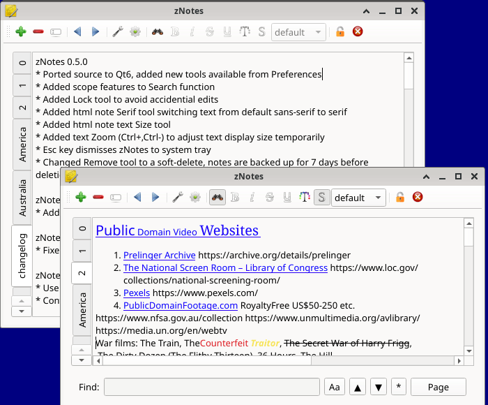

# zNotes (Qt 6 Edition)

**zNotes** is a lightweight cross-platform notes management application. 



## About This Fork

This fork of [proton/zNotes](https://github.com/proton/zNotes) has been ported to **Qt 6** and updated with a number of new features.

### ✨ Key Features & Enhancements

* **Native Qt 6 Architecture:** Fully migrated to Qt 6 without relying on legacy compatibility modules (`QtCore5Compat`).
* **Customizable Toolbar & Widgets:** Fully configurable toolbars via the Preferences dialog, allowing you to reorder, add, or remove tools on the fly—including the dynamic **HTML Font Size** dropdown and **Serif Font** toggle.
* **Rich Text & Layout Controls:** 
  * Application-wide **Zoom** shortcuts (`Ctrl +`, `Ctrl -`, `Ctrl =`).
  * **Read-Only / Lock** mode to prevent accidental edits.
  * Robust handling of relative font size adjustments (`x-small` to `xx-large`) and clean default style resets.
* **Improved Search Functionality:** Fast, integrated search bar with intuitive keyboard shortcuts (`Ctrl+F`, `Esc`).
* **Safe File Management (Soft-Delete):** Deleted notes are safely renamed to `.bk` files, with an automated startup purge that cleans up backups older than 7 days.
* **Full Backwards Compatibility:** Works seamlessly with existing note structures and configuration profiles.

---

### 🛠️ Build Instructions (FreeBSD / Linux)

#### 1. Install Dependencies (FreeBSD Example)
```bash
pkg install qt6-base qt6-tools
